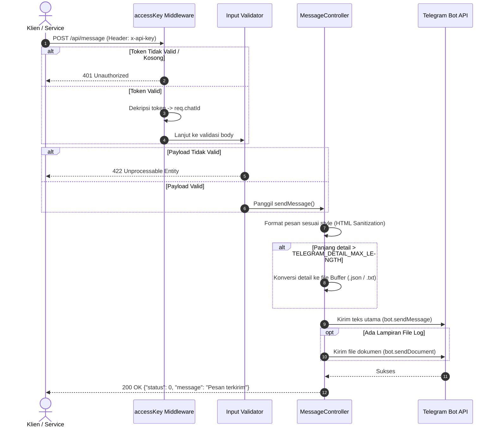

# 🏗️ Arsitektur & Keamanan

Dokumen ini menjelaskan rancangan arsitektur internal, struktur direktori, serta mekanisme keamanan autentikasi tanpa database (*stateless authentication*) pada service **Telegram Notify Log Bot API**.

---

## 📂 Struktur Direktori Proyek

```text
telegram-bot-api/
├── api/                      # Serverless handler (khusus deployment Vercel)
│   ├── index.js              # Entrypoint serverless
│   └── webhook.js            # Telegram webhook handler (Vercel)
├── src/                      # Source code utama aplikasi Express
│   ├── controller/           # Business logic
│   │   └── messageController.js # Formatting pesan, attachment handler, & pengiriman bot
│   ├── middleware/           # Express middleware
│   │   └── accessKey.js      # Validasi & dekripsi header x-api-key ke chatId
│   ├── routes/               # Routing API
│   │   ├── index.js          # Main router
│   │   └── message.js        # Route POST /api/message
│   ├── utils/                # Helper / Utilitas
│   │   ├── crypto.js         # Enkripsi & dekripsi Chat ID (AES-256-CBC)
│   │   ├── telegramBotConfig.js # Inisialisasi node-telegram-bot-api
│   │   └── validation.js     # Helper express-validator
│   ├── app.js                # Inisialisasi Express & konfigurasi middleware
│   └── index.js              # Entrypoint lokal (listener port)
├── docs/                     # Dokumentasi teknis terpecah
│   ├── architecture.md       # Arsitektur & mekanisme keamanan enkripsi
│   ├── api-reference.md      # Spesifikasi lengkap endpoint API
│   ├── development.md        # Panduan setup & penambahan fitur baru
│   └── webhook.md            # Panduan setup & manajemen Webhook Telegram
├── .env.example              # Template variabel lingkungan
├── DEVELOPMENT.md            # Entrypoint ringkasan dev
├── README.md                 # Dokumentasi utama proyek
└── package.json
```

---

## 🔐 Mekanisme Autentikasi Stateless (AES-256-CBC)

Service ini dirancang **tanpa database** (zero-database dependency). Identitas tujuan pesan (*Telegram Chat ID*) langsung dienkripsi menjadi sebuah token akses:

### 1. Siklus Penerbitan Token (`/subscribe`)
1. Pengguna membuka bot Telegram dan menjalankan `/subscribe` atau `/start subscribe`.
2. Bot membalas dengan tombol inline **Request Kode**.
3. Ketika tombol ditekan, Telegram mengirimkan event `callback_query` yang memuat Chat ID pengguna (`id`).
4. Webhook memanggil helper `encodeWithSecretKey(id)`:
   - Menggunakan algoritma `aes-256-cbc`.
   - Menghasilkan SHA-256 hash dari `APP_KEY` sebagai cipher key.
   - Menggunakan `IV_SECRET` (16-byte hex).
   - Menghasilkan string heksadesimal terenkripsi.
5. Bot membalas Chat ID pengguna dengan kode hex tersebut. Kode ini bertindak sebagai **API Key (`x-api-key`)**.

### 2. Validasi Permintaan Masuk (Middleware `accessKey`)
1. Klien mengirim permintaan HTTP dengan header `x-api-key: <token_hex>`.
2. Middleware [src/middleware/accessKey.js](file:///Users/kominfoimam/Project/Docker/telegram-bot-api/src/middleware/accessKey.js) menangkap header tersebut.
3. Token didekripsi menggunakan `decodeWithSecretKey(token)`.
4. Jika valid, Chat ID numerik diperoleh dan disimpan ke `req.chatId` untuk diteruskan ke controller.
5. Jika token tidak valid / rusak / hasil tamper, server langsung merespons dengan HTTP `401 Unauthorized`.

---

## 🔄 Diagram Alur Pemrosesan Pesan



---

## 🛡️ Catatan Keamanan untuk Produksi

1. **Rotasi Kunci:**
   Karena Chat ID tersimpan langsung di dalam token secara terenkripsi statis, mengubah `APP_KEY` atau `IV_SECRET` di kemudian hari akan menyebabkan seluruh token yang telah dibagikan ke pengguna menjadi *invalid*.
2. **Dynamic IV (Rekomendasi Peningkatan):**
   Implementasi saat ini menggunakan `IV_SECRET` statis dari `.env`. Untuk mencegah serangan kriptografi *known-plaintext*, disarankan menggunakan IV acak per enkripsi dan menyematkannya di depan string ciphertext (misal: `IV_HEX:CIPHERTEXT_HEX`).
