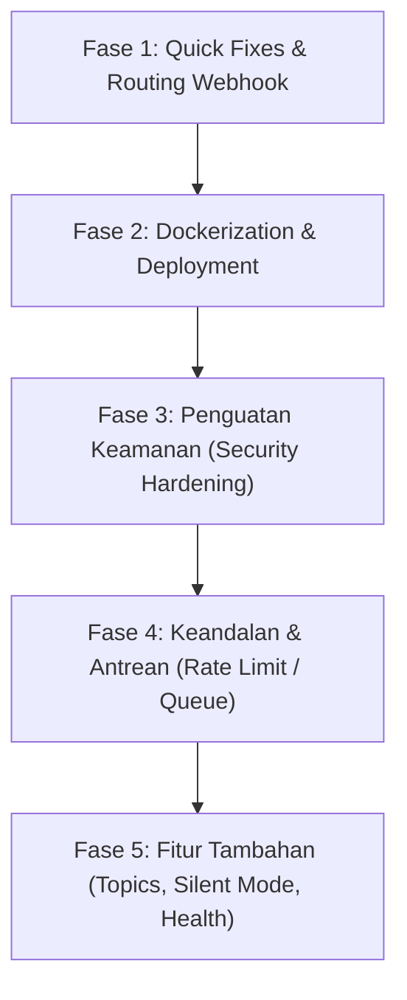

# 📋 Rencana Perbaikan & Pengembangan (Roadmap)

Dokumen ini memuat daftar rencana aksi perbaikan dan pengembangan bertahap untuk service **Telegram Notify Log Bot API**.

---

## 🧭 Tahapan Eksekusi

---

## 🛠️ Rincian Rencana per Fase

### 🔴 Fase 1: Perbaikan Bug & Inkonsistensi Routing (Prioritas Tinggi)
1. **Hubungkan Webhook Route di Mode Express Lokal:**
   - **Masalah:** File `api/webhook.js` saat ini hanya dipanggil di Vercel Serverless. Pada server Express lokal (`src/app.js`), rute `POST /api/webhook` belum didaftarkan sehingga bot Telegram mengembalikan HTTP 404 saat pengguna mengirim perintah `/subscribe` di lokal.
   - **Solusi:** Buat route Express `POST /api/webhook` yang menggunakan logic pemrosesan webhook yang sama.
2. **Kondisional Webhook Setup pada Startup:**
   - **Masalah:** `bot.setWebHook()` dipanggil langsung saat file `src/app.js` dimuat, bahkan ketika `APP_URL` belum diatur.
   - **Solusi:** Hanya jalankan `bot.setWebHook()` jika `process.env.APP_URL` terisi dan valid.

---

### 🐳 Fase 2: Dockerization & Konfigurasi Container
1. **Pembuatan `Dockerfile`:**
   - Gunakan base image `node:20-alpine` yang ringan dan terisolasi.
   - Jalankan dengan non-root user untuk keamanan.
2. **Pembuatan `docker-compose.yml`:**
   - Port mapping `3000:3000`, env file binding, dan restart policy (`unless-stopped`).
3. **Pembaruan Panduan Docker:**
   - Catat instruksi build & jalankan container ke dalam dokumentasi utama.

---

### 🛡️ Fase 3: Penguatan Keamanan (Security Hardening)
1. **Verifikasi Webhook Secret Token:**
   - Gunakan `X-Telegram-Bot-Api-Secret-Token` untuk memvalidasi bahwa setiap panggilan webhook benar-benar berasal dari server resmi Telegram.
2. **Upgrade Enkripsi Token (Dynamic IV):**
   - Gunakan 16-byte random IV per token (`<iv_hex>:<ciphertext_hex>`) dengan fallback backwards-compatible agar API key lama tetap bisa digunakan.
3. **Rate Limiting di Sisi API Express:**
   - Pasang `express-rate-limit` pada endpoint `POST /api/message` untuk mencegah spam / abuse.

---

### ⚡ Fase 4: Keandalan & Penanganan Limit Telegram (Reliability & Queue)
1. **Queue Buffer untuk Mencegah HTTP 429 Telegram:**
   - Telegram membatasi ~30 pesan/detik global dan ~1 pesan/detik per chat.
   - Implementasikan in-memory queue dengan throttling dan auto-retry saat terkena *Too Many Requests (429)* agar log tidak hilang saat terjadi *spike error*.

---

### ✨ Fase 5: Penambahan Fitur Baru (Feature Enhancements)
1. **Dukungan Topik Grup Telegram (`message_thread_id`):**
   - Menambahkan opsi `thread_id` agar pesan dapat dikirim ke sub-topik tertentu pada Telegram Group (Forum).
2. **Mode Notifikasi Senyap (`disable_notification`):**
   - Menambahkan flag `silent: true` untuk log non-kritis (INFO/DEBUG) agar tidak membunyikan dering ponsel.
3. **Endpoint Health Check & Validasi Key:**
   - `GET /api/health`: Uptime, status memori, dan status Telegram Bot.
   - `GET /api/validate`: Menguji apakah `x-api-key` masih valid tanpa mengirim pesan nyata.

---

## 📊 Matriks Ringkasan Rencana

| Item Rencana | Fase | Dampak | Status |
| :--- | :---: | :---: | :---: |
| Fix Express Local Webhook Routing | Fase 1 | Kritis (Bug Fix) | ✅ Selesai |
| Safe Webhook Setup on Startup | Fase 1 | Stabilitas | ✅ Selesai |
| Dockerfile & docker-compose.yml | Fase 2 | Kemudahan Deploy | ✅ Selesai |
| Webhook Secret Token Verification | Fase 3 | Keamanan | ✅ Selesai |
| Dynamic IV AES-256 | Fase 3 | Keamanan | ✅ Selesai |
| API Rate Limiter | Fase 3 | Keamanan | ✅ Selesai |
| Telegram Topic / Forum Support (`thread_id`) | Fase 5 | Fitur Baru | ✅ Selesai |
| Silent Notification (`silent`) | Fase 5 | Fitur Baru | ✅ Selesai |
| Health Check & Key Validate Endpoint | Fase 5 | Monitoring | ✅ Selesai |
| In-Memory Queue Buffer (Anti 429) | Fase 4 | Kestabilan Lanjutan | ⏳ Next Plan |
